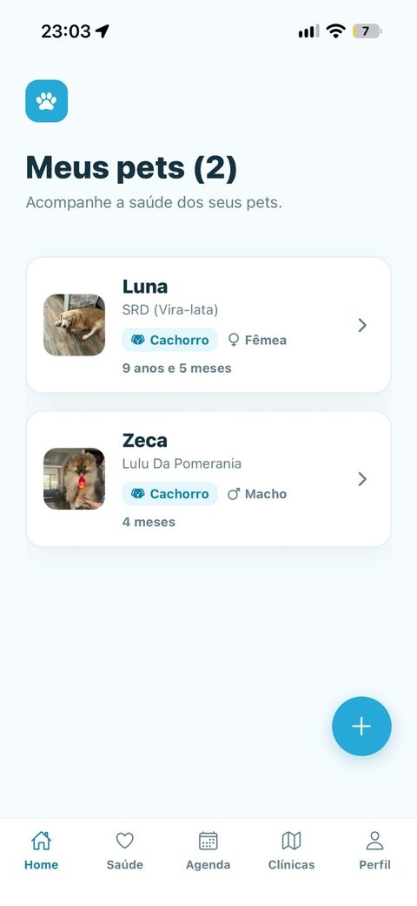
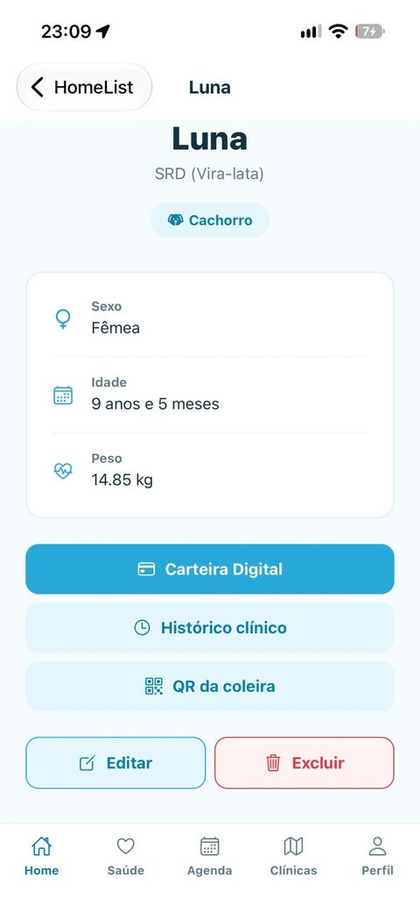
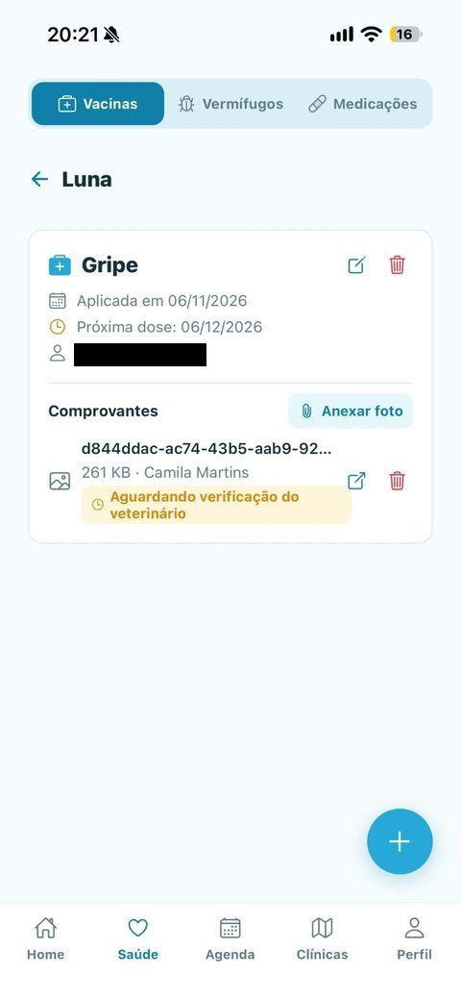
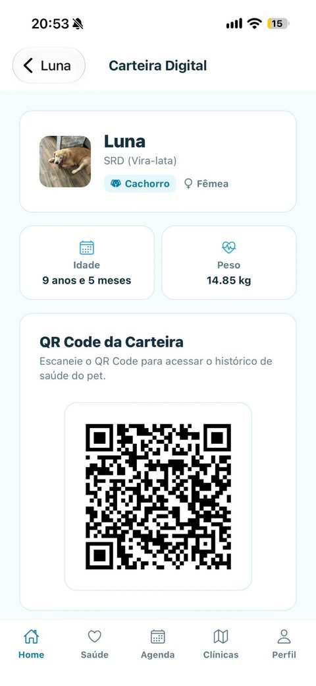
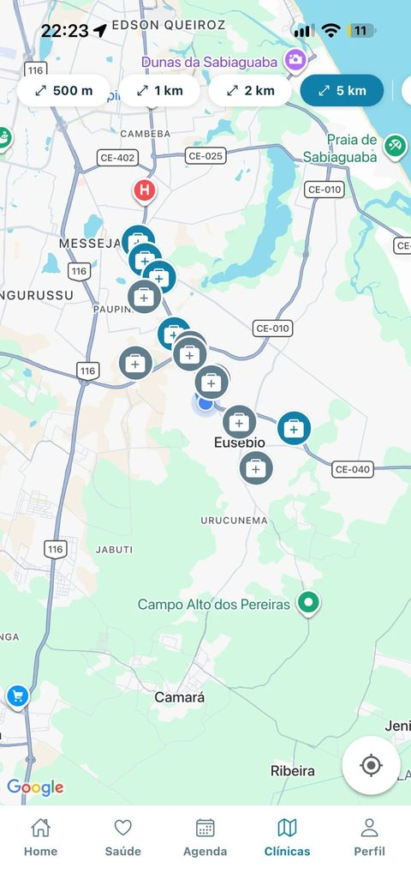
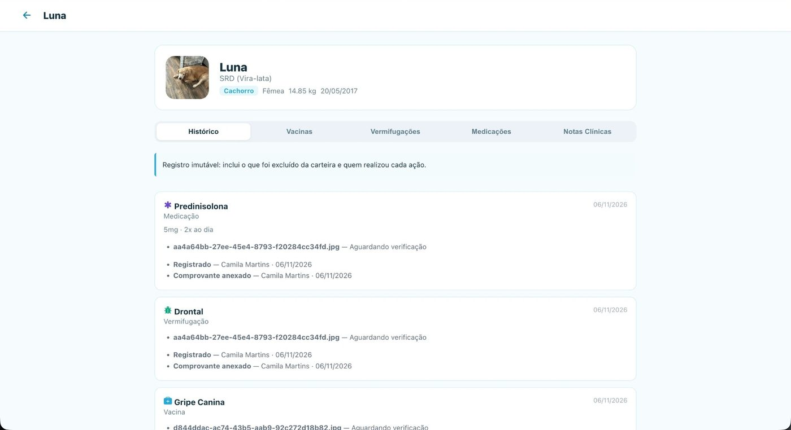
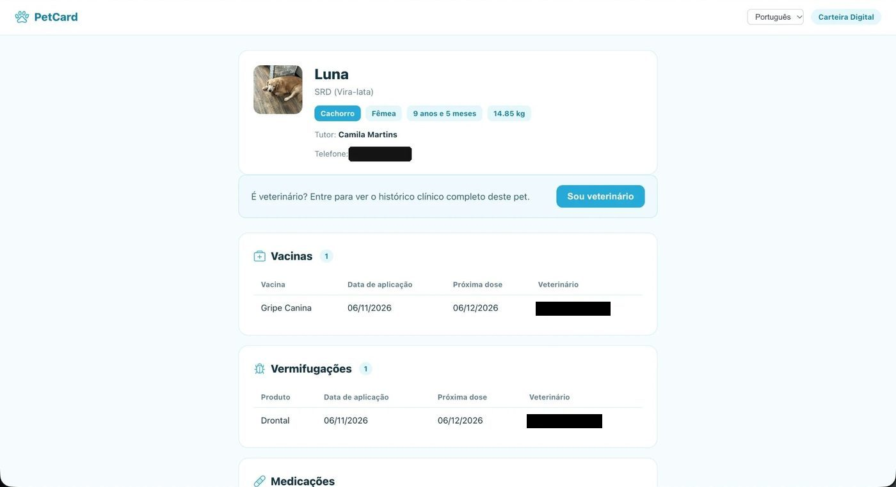
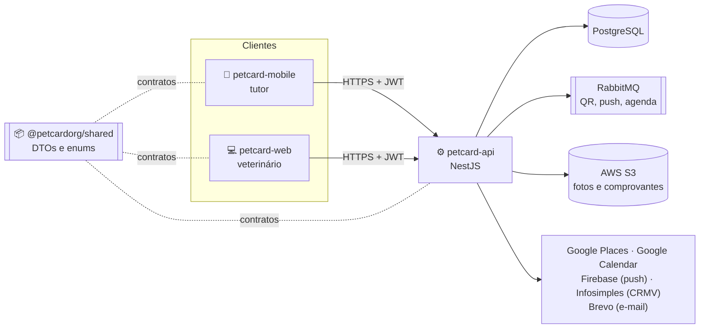

# PetCard

**Ecossistema digital de saúde pet: a carteira de vacinação do seu animal no celular, compartilhável por QR Code e atualizada pelo veterinário em tempo real.**

[Sobre](#sobre) · [Telas](#telas) · [Repositórios](#repositórios) · [Arquitetura](#arquitetura) · [Documentação](#documentação) · [Equipe](#equipe)

---

## Sobre

O PetCard reúne em um só lugar a saúde do animal de estimação. O **tutor** usa o aplicativo para registrar vacinas, vermífugos e medicações, anexar fotos de comprovantes, encontrar clínicas próximas e agendar consultas que vão direto para o Google Agenda. O **veterinário** usa a área web: lê o QR Code da carteira, vê o histórico completo do pet e registra atendimentos assinados com o próprio CRMV, que chegam ao app do tutor na hora.

Este repositório é a **documentação central** do projeto: artefatos do TCC, decisões de arquitetura, auditorias, QA e o board da entrega.

### Principais funcionalidades

| | Tutor (app) | | Veterinário (web) |
|:-:|---|:-:|---|
| 📋 | Prontuário com vacinas, vermífugos e medicações | 🔍 | Acesso ao pet pela leitura do QR Code |
| 📱 | Carteira digital por QR Code, link ou PDF | 🩺 | Notas clínicas e registros assinados com CRMV |
| 📍 | Clínicas próximas no mapa, com rota e ligação | ✅ | Verificação dos comprovantes enviados pelo tutor |
| 📅 | Agendamentos sincronizados com o Google Agenda | 🧾 | Histórico imutável de tudo o que foi registrado |
| 🔔 | Lembretes de doses e consultas por notificação | 🪪 | CRMV conferido no CFMV no cadastro |
| 🏷️ | QR de coleira para pet perdido | 🌐 | Interface em português e inglês |

## Telas

**App do tutor**

Home · Perfil do pet · Saúde · Carteira digital · Clínicas próximas

**Área do veterinário**

Prontuário com histórico imutável · Carteira pública aberta pelo QR Code

## Repositórios

| Repositório | O que é | CI | Cobertura |
|---|---|:-:|:-:|
| [**petcard-api**](https://github.com/PetCardOrg/petcard-api) | API REST em NestJS, banco, filas e integrações |  |  |
| [**petcard-web**](https://github.com/PetCardOrg/petcard-web) | Área do veterinário em React + Vite |  |  |
| [**petcard-mobile**](https://github.com/PetCardOrg/petcard-mobile) | App do tutor em React Native + Expo |  |  |
| [**petcard-shared**](https://github.com/PetCardOrg/petcard-shared) | Pacote `@petcardorg/shared` com DTOs e enums |  |  |
| **petcard-docs** | Documentação central (você está aqui) | | |

## Arquitetura

Arquitetura multirepo ([ADR-001](architecture/adr/001-multirepo-strategy.md)): web e mobile falam só com a API, e os três compartilham os contratos pelo pacote `@petcardorg/shared`.

### Stack

| Camada | Tecnologia |
|---|---|
| App do tutor | React Native 0.88 + Expo SDK 58 + TypeScript |
| Área do veterinário | React 19 + Vite 8 + React Router 7 + TypeScript |
| API | NestJS 11 + Node.js 20 LTS + TypeScript (strict) |
| Banco e ORM | PostgreSQL 16 (imagem PostGIS 3.4) + Prisma 6 |
| Mensageria | RabbitMQ 3, com DLX/DLQ e retry por fila |
| Arquivos | AWS S3, com links temporários para comprovantes ([ADR-013](architecture/adr/013-comprovantes-anexados-a-registros-de-saude.md)) |
| Autenticação | JWT próprio (HS256 + bcrypt) e login com Google ([ADR-008](architecture/adr/008-fluxo-cadastro-e-login.md)) |
| Notificações | Firebase Cloud Messaging |
| Contratos | `@petcardorg/shared` no GitHub Packages |
| Cache | Redis 7 (provisionado no compose, ainda sem uso no código) |

### Ambientes

Toda a infraestrutura usa camadas gratuitas permanentes ([ADR-010](architecture/adr/010-infra-de-staging-render-supabase-cloudamqp.md), [ADR-011](architecture/adr/011-cd-de-producao-github-environments-e-dlx-por-ambiente.md), [ADR-012](architecture/adr/012-dominio-de-producao-subdominios-gratuitos-e-vercel.md)).

| Peça | Provedor | Deploy |
|---|---|---|
| API | Render (Docker) · [petcard-api-v1yi.onrender.com](https://petcard-api-v1yi.onrender.com) | `develop` → staging automático · `main` → produção com aprovação manual |
| Web | Vercel · [petcard-web.vercel.app](https://petcard-web.vercel.app) | SPA estática gerada pelo Vite |
| Banco | Supabase (PostgreSQL) | migrations do Prisma |
| Fila | CloudAMQP (RabbitMQ) | exchanges de dead-letter separadas por ambiente |
| App | EAS Build (Expo) | builds iOS e Android |

## Documentação

| Documento | Descrição |
|---|---|
| [TAP](docs/tap.md) | Termo de Abertura do Projeto: objetivo, escopo, requisitos e cronograma |
| [DAS](docs/das.md) | Documento de Arquitetura de Software: camadas, entidades e casos de uso |
| [ADRs](architecture/adr/) | 14 registros de decisão de arquitetura, do multirepo à infraestrutura de produção |
| [Auditorias técnicas](docs/auditorias/) | Revisões de qualidade de jun/2026, jul/2026 e out/2026 |
| [Roteiro de testes manuais](docs/qa/roteiro-testes-manuais.md) | Passos e resultado esperado dos 16 casos de uso |
| [Evidências dos requisitos](docs/qa/evidencias-requisitos-petcard.md) | Prints e classificação de cada RF e RNF em produção (06 a 08/11/2026) |
| [API (Postman)](docs/api/README.md) | OpenAPI e collection do Postman com todos os endpoints |
| [Teste de usabilidade](docs/usabilidade/README.md) | Respostas dos 28 participantes (apêndice do TCC) |

Índice completo em [`docs/README.md`](docs/README.md). Para contribuir, veja o [guia de contribuição](CONTRIBUTING.md) (branches, commits e PRs valem para os 5 repositórios).

## Equipe

| Álvaro Araújo | Camila Martins | Ricardo Temporal |
|:-:|:-:|:-:|

Sem papéis fixos: os três trabalharam em todas as frentes, da API ao app. Projeto de Trabalho de Conclusão de Curso em Ciência da Computação, Universidade de Fortaleza (UNIFOR), 2026.

## Licença

Distribuído sob a licença [MIT](LICENSE).
